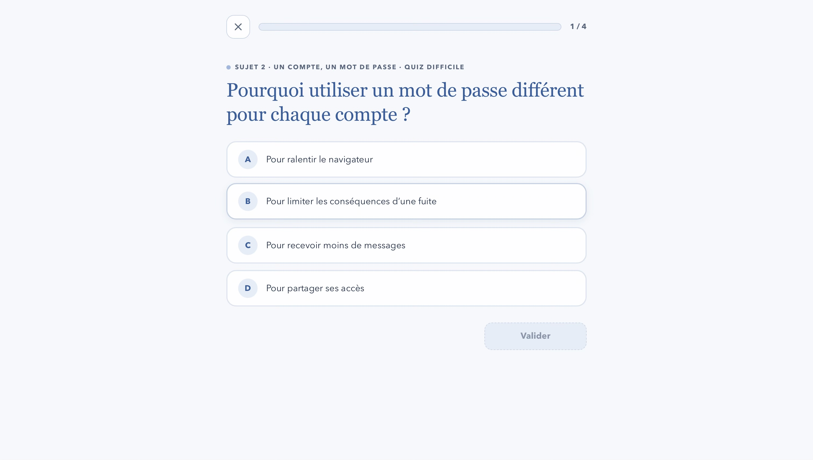
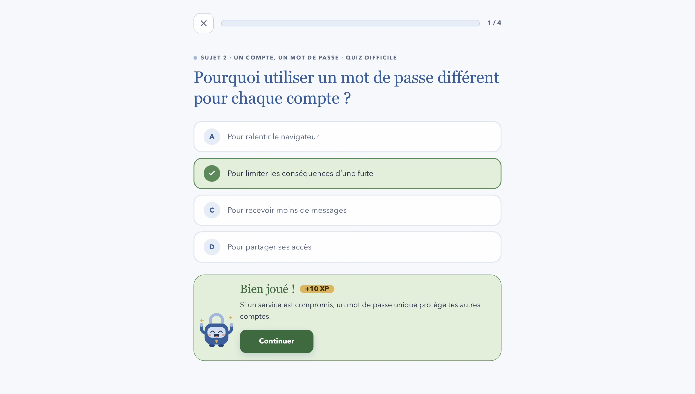
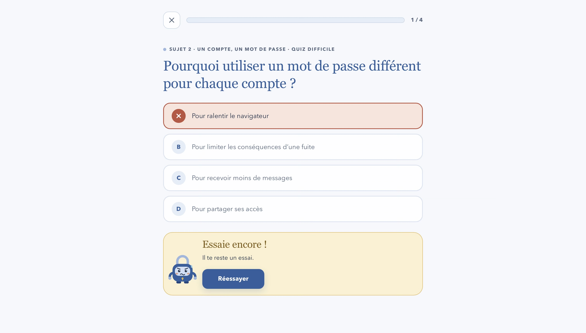
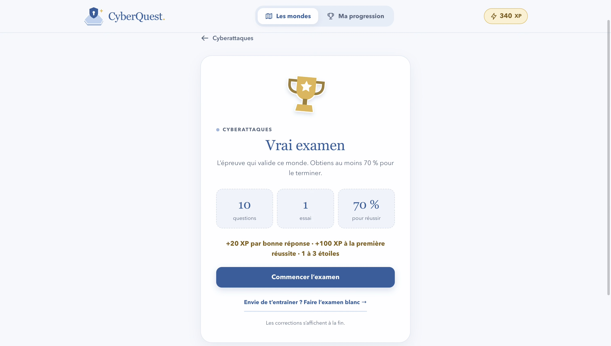
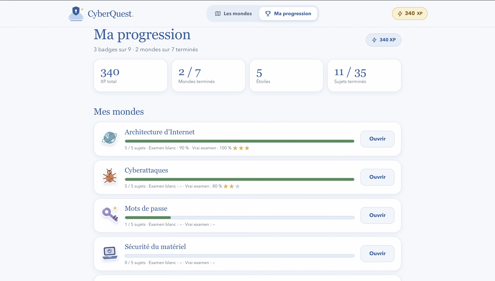
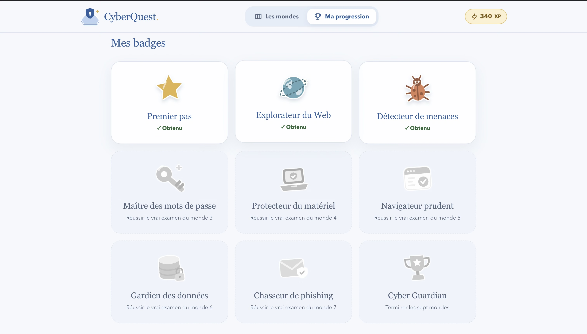

## TP2 — Conception de la maquette du site web

**Auteur :**  Tous

---

## 1. Maquette de la carte des sept mondes

*Figure 1 — Maquette de la carte principale CyberQuest.*

---

## 2. Maquette du parcours d'apprentissage

Lorsqu'un utilisateur choisit un monde, il accède à son parcours d'apprentissage.

*Figure 2 — Parcours du monde « Mots de passe » avec les différentes activités.*

---

## 3. Maquette de l'interface des quiz

*Figure 3 — Interface d'une question avec une réponse sélectionnée.*

### 3.1. Gestion des bonnes réponses

*Figure 4 — Retour visuel après une bonne réponse.*

### 3.2. Gestion des mauvaises réponses

*Figure 5 — Retour visuel après une mauvaise réponse avec possibilité de réessayer.*

---

## 4. Maquette des examens

### 4.1. Examen blanc

L'examen blanc constitue un entraînement facultatif.

*Figure 6 — Présentation de l'examen blanc.*

### 4.2. Vrai examen

*Figure 7 — Présentation du vrai examen permettant de valider un monde.*

---

## 5. Système de progression

*Figure 8 — Tableau de progression de l'utilisateur.*

---

## 6. Système de badges

*Figure 9 — Présentation des badges obtenus et des récompenses encore verrouillées.*

